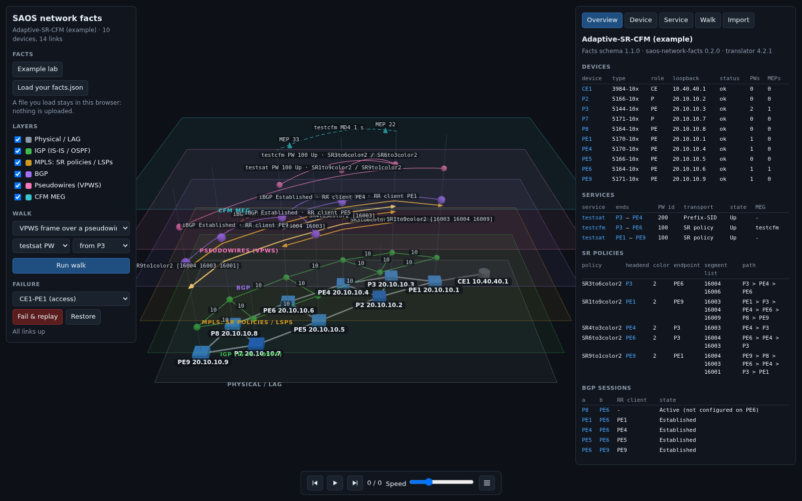

# saos-network-facts

Extract per-device network facts from SAOS 6/8/10 configurations into a versioned, vendor-neutral schema.

Give it a directory of device configurations (and optionally a containerlab topology) and it writes
one JSON facts file: per device, the hostname, interfaces and addresses, ports, VLANs, LAGs,
forwarding domains and flow points, IS-IS (level, area, NET), OSPF (instances, areas, interfaces),
segment routing (SRGB, prefix and node SIDs, SR policies), BGP (neighbours, route reflection),
MPLS-TP co-routed tunnels, pseudowires and L2VPN services, and CFM MEPs. Diagram tools,
topology viewers and presentation builds read that file instead of parsing configurations
themselves. The file follows a published JSON Schema, so readers can pin a schema version.

- **Python** (`saos_network_facts`, CLI `saos-network-facts`): the extractor.
- **npm** (`@ciena/saos-network-facts`, in [`js/`](js/)): the schema, TypeScript types and a reader.
- **Viewer** ([`viewer/`](viewer/)): a static site that shows a facts file in 3D; released as a
  download to stage next to your own facts ([below](#use-the-viewer-in-your-repo)).

## Install

```bash
pip install "git+https://github.com/ciena/saos-network-facts@v0.3.1"
saos-network-facts --version
```

Python 3.11 or later; the only dependencies are PyYAML and jsonschema.

## Extract

```bash
# a directory of configurations: one device per file (PE1.cfg) or per subdirectory (PE1/01-base.cfg, ...)
saos-network-facts extract --configs configs/ -o facts.json

# a containerlab lab: node kinds and types from the topology, configs from startup-config
saos-network-facts extract --clab topo.clab.yml -o facts.json

# both: the topology for the devices, another directory for their configurations
saos-network-facts extract --clab topo.clab.yml --configs solutions/ -o facts.json

# device types the files do not say, for a plain configs directory
saos-network-facts extract --configs configs/ --platform-map devices.yaml -o facts.json

saos-network-facts validate facts.json
```

How files map to devices:

- a file is a device named after the file up to its first dot (`PE_1.cfg.partial` is `PE_1`); files
  that share that name are one device, applied in name order (`R1.day0.cfg`, `R1.day1.cfg`);
- a subdirectory is a device; its files are applied in name order;
- `--clab`: every node is a device; its `startup-config` is its configuration unless `--configs`
  has files for it. Nodes of other kinds (Linux hosts) are recorded as `skipped`;
- `--platform-map`: YAML or JSON, `devices: {NAME: {type, platform, extractor, configs}}` (or
  `NAME: TYPE`), for what the inputs do not say.

Which parser reads a device: the platform map's `extractor`, else the device type (`*-6x`, `*-8x`:
SAOS 6/8; `*-10x`: SAOS 10), else the containerlab kind (`ciena_saos`: SAOS 10), else the files
themselves (XML, or CLI not written as SAOS 6 `verb [noun] action` commands, is SAOS 10).

Other options: `--recipe NAME` labels every record, `--no-saos10` skips SAOS 10 devices, `--jobs N`
sets parallel translator calls, `--quiet` prints only problems. The exit status is 1 when a device
is `error` or `partial` (the facts file is still written), 2 on bad arguments.

### SAOS 10 and the translator

SAOS 6 and SAOS 8 configurations are parsed here. SAOS 10 configurations (CLI or NETCONF XML) are
parsed by the SAOS 10 translator, whose `convert_cli` / `convert_xml` MCP tools return the
configuration as JSON keyed by YANG module; this package walks that JSON. No translator code ships
here: the client speaks only the MCP protocol over HTTP.

By default the client uses the **hosted translator** at `https://dgwl7tykn828q.cloudfront.net`
(`POST /mcp`). It needs no account or token, so `saos-network-facts extract` works out of the box on
SAOS 10 configurations. Each SAOS 10 configuration file is sent to that endpoint to be parsed; to
keep configurations on your machine, use a local translator checkout (`--translator-root`), or skip
SAOS 10 devices with `--no-saos10`. SAOS 6 / 8 files never leave your machine. The translator in use
is recorded in the facts file (`generator.translator`).

| Setting | Flag | Environment |
|---|---|---|
| Translator endpoint (default: the hosted translator above) | `--translator-url URL` | `SAOS10_TRANSLATOR_URL` |
| Bearer token, sent only when set (the convert tools need none from translator 4.2.0) | | `SAOS10_TRANSLATOR_TOKEN` |
| A local translator checkout instead of an endpoint (run under its virtualenv) | `--translator-root DIR` | `SAOS10_TRANSLATOR_ROOT` |
| SAOS 10 release to parse for (default `10_12_00_0228`) | `--saos-version V` | |

The flag wins over the environment; `SAOS10_TRANSLATOR_URL` wins over `SAOS10_TRANSLATOR_ROOT`.
When the endpoint throttles (HTTP 429), fails (5xx) or the connection drops, each request is tried
up to 3 times, waiting 1 s and then 2 s; other errors (a 4xx such as 401) fail at once. `--jobs N`
(default 8) bounds the parallel requests for one device; lower it if you are throttled.

A file the translator rejects is listed in the device's `failed_templates` and the device is
`partial`; its other files still count.

## The facts file

```json
{
  "schema_version": "1.2.0",
  "generator": {"name": "saos-network-facts", "version": "0.3.1", "translator": "translator 4.2.0 (mcp, https://...)"},
  "devices": [
    {
      "device": "PE1", "type": "5164", "platform": "cn5164", "extractor": "saos10",
      "templates": ["configs/PE1.cfg"], "status": "ok",
      "facts": {
        "hostname": "PE1",
        "interfaces": [{"name": "lb0", "kind": "loopback", "ip": "192.0.2.1/32", "isis": "CORE", "...": "..."}],
        "isis": {"instances": [{"name": "CORE", "level": "level-2", "net": "49.0001.1920.0000.2001.00", "area_id": "49.0001", "...": "..."}]},
        "segment_routing": {"srgb": [{"instance": "CORE", "lower": "16000", "upper": "23999"}],
                            "prefix_sids": [{"prefix": "192.0.2.1/32", "sid": "1", "value_type": "index", "node": true, "...": "..."}]},
        "...": "..."
      }
    }
  ]
}
```

The full schema, with a description on every field, is
[`src/saos_network_facts/schema/facts-v1.schema.json`](src/saos_network_facts/schema/facts-v1.schema.json)
(also shipped in the npm package as `@ciena/saos-network-facts/schema`). Per device record:

| Field | |
|---|---|
| `device`, `type`, `platform` | the device name, its type as the inputs give it, the SAOS 10 translator platform |
| `extractor` | `saos6` (SAOS 6/8), `saos10`, or null |
| `templates` | its configuration files, in apply order |
| `status` | `ok`, `partial` (some SAOS 10 files failed), `error`, `skipped` (with `reason`) |
| `facts` | null unless `ok` / `partial` |

Facts (all devices): `hostname`, `interfaces`, `gateway`, `vlans`, `ports`, `lags`, `sub_ports`,
`rings`, `peers` (MPLS VCs, MPLS-TP tunnel ends, BGP neighbours with `route_reflector_client`),
`isis` (`instances` with `level`, `nets`, `net`, `area_id`, `system_id`, `sr_enabled`; `interfaces`
with `level` and `type`), `segment_routing` (`srgb`, `prefix_sids`, `policies`, `segment_lists`),
`bgp` (`instances` with `router_id`, `cluster_id`, `route_reflector`), `pseudowires` (`peer`,
`pw_id`, labels, `mode`, `tunnel_type` and `tunnel_color` since schema 1.1, `service`,
`service_type`), `cfm` (`meps` with `md`, `ma`, `mep_id`, `level`, `direction`, `port`, `vlan`),
`lines`, `recognised`. SAOS 10 only: `fds`, `fps`,
`classifiers`, `vrfs`, `segments` (EVPN ethernet segments), `objects`, and since schema 1.2 `ospf`
(`instances` with `router_id`, `vrf` and `areas` with their `networks`; `interfaces` with `area`,
`type`, `metric`, timers, `passive`, `bfd`), `tp_corouted_tunnels` (each node's segment of a static
MPLS-TP co-routed tunnel: `source`, `destination`, `type` ingress / transit / egress, `role`,
`primary` of a backup, forward and reverse in / out labels, next / previous hop, LSP `bfd`) and
`l2vpn_services` (`fd`, `pseudowires`, `mtu`, `signaling_type`).

Values read from a configuration are text as written (`"mtu": "9000"`); flags the extractor derives
are booleans. Segment routing, BGP, OSPF and MPLS-TP tunnels are extracted from SAOS 10 only.

**Compatibility.** `schema_version` is semver. Within 1.x, new versions only add optional fields, so
a reader must ignore fields it does not know; a breaking change is schema 2.

## Example

**[ciena.github.io/saos-network-facts](https://ciena.github.io/saos-network-facts/)** shows the
facts of a ten-device SAOS 10 lab (segment routing, SR policies, VPWS pseudowires, CFM, iBGP route
reflection) in the [viewer](viewer/): one plane per layer over the topology, a panel per device and
per service, packet walks and link-failure replays. *Load your facts.json* there to see your own
network; the file stays in your browser.



The example lives in [`examples/adaptive-sr-cfm/`](examples/adaptive-sr-cfm/): the rendered
startup configurations, the platform map and the facts file. To regenerate the facts and the site
from the committed configurations ([SOURCE.md](examples/adaptive-sr-cfm/SOURCE.md) has the details):

```bash
cd examples/adaptive-sr-cfm
saos-network-facts extract --configs configs --platform-map devices.yaml --recipe Adaptive-SR-CFM -o facts.json
cd ../../viewer && npm ci && npm run build      # the site, in dist/
```

The site is built by `.github/workflows/pages.yml`: deployed to GitHub Pages from `main`, and
uploaded as the `site-preview` artifact on every pull request.

## Use the viewer in your repo

Every release carries the built viewer, `saos-network-facts-viewer-X.Y.Z.tgz`: a static site
(`index.html`, `assets/`) with relative paths, so it runs from any directory of any web server,
private GitHub Pages included. Put your facts files beside it and point the page at them:

| URL | Opens |
|---|---|
| `index.html?facts=facts.json` | that facts file (relative to the page) |
| `index.html?facts=facts.json&positions=positions.json` | the same, with authored node positions |
| `index.html?labs=labs/index.json` | the default lab of a lab index, with a picker for the others |
| `index.html?labs=labs/index.json&lab=core` | lab `core` of that index |
| `index.html?lab=core` | lab `core` of `labs/index.json` beside the page |
| `index.html` | the bundled example; *Load your facts.json* still opens a local file |

A lab index lists facts files (URLs relative to the index):

```json
{
  "labs": [
    {"id": "core", "title": "Core lab", "facts": "core/facts.json", "positions": "core/positions.json", "default": true},
    {"id": "metro", "title": "Metro ring", "facts": "metro/facts.json"}
  ]
}
```

Positions are optional: `{"positions": {"PE1": [100, 300], "P1": [300, 150], ...}}`, diagram
coordinates in any unit with y down, one per device (else the view lays the topology out itself).
In CI, for example a GitHub Pages workflow:

```yaml
      - name: Stage the viewer with our facts
        env:
          GH_TOKEN: ${{ github.token }}
        run: |
          mkdir -p site
          gh release download v0.3.1 --repo ciena/saos-network-facts \
            --pattern 'saos-network-facts-viewer-*.tgz' --output viewer.tgz
          tar -xzf viewer.tgz -C site
          mkdir -p site/labs && cp -r facts/* site/labs/    # facts files, positions and labs/index.json
      - uses: actions/upload-pages-artifact@v3
        with:
          path: site
```

Then link to `.../index.html?labs=labs/index.json`. The page fetches the facts from the same site,
so they stay as private as the site that serves them.

## Reading facts from JavaScript / TypeScript

```ts
import { readFacts } from "@ciena/saos-network-facts/node";
import { devicesByName, interfacesOnPort, isisArea } from "@ciena/saos-network-facts";

const facts = readFacts("facts.json");          // schema 1.x (or a pre-schema bare list)
const pe1 = devicesByName(facts).get("PE1")!;
interfacesOnPort(pe1, "1");                     // [{ name: "PE1-PE2", ip: "198.51.100.0/31", vlan: null, isis: "CORE", lag: null }]
isisArea(pe1.isis.instances[0]!);               // "49.0001"
```

The main entry point has no Node dependencies (`parseFacts(json)` for browsers); see [`js/`](js/).

## Development

See [CONTRIBUTING.md](CONTRIBUTING.md). In short: `pip install -e '.[dev]'`, `ruff check .`,
`pytest`; in `js/`: `npm ci`, `npm test`. Tests never call a translator: SAOS 10 replies are
recorded in `tests/fixtures/pivots.json`.

## License

[Apache-2.0](LICENSE). Copyright 2026 Ciena Corporation; see [NOTICE](NOTICE).
